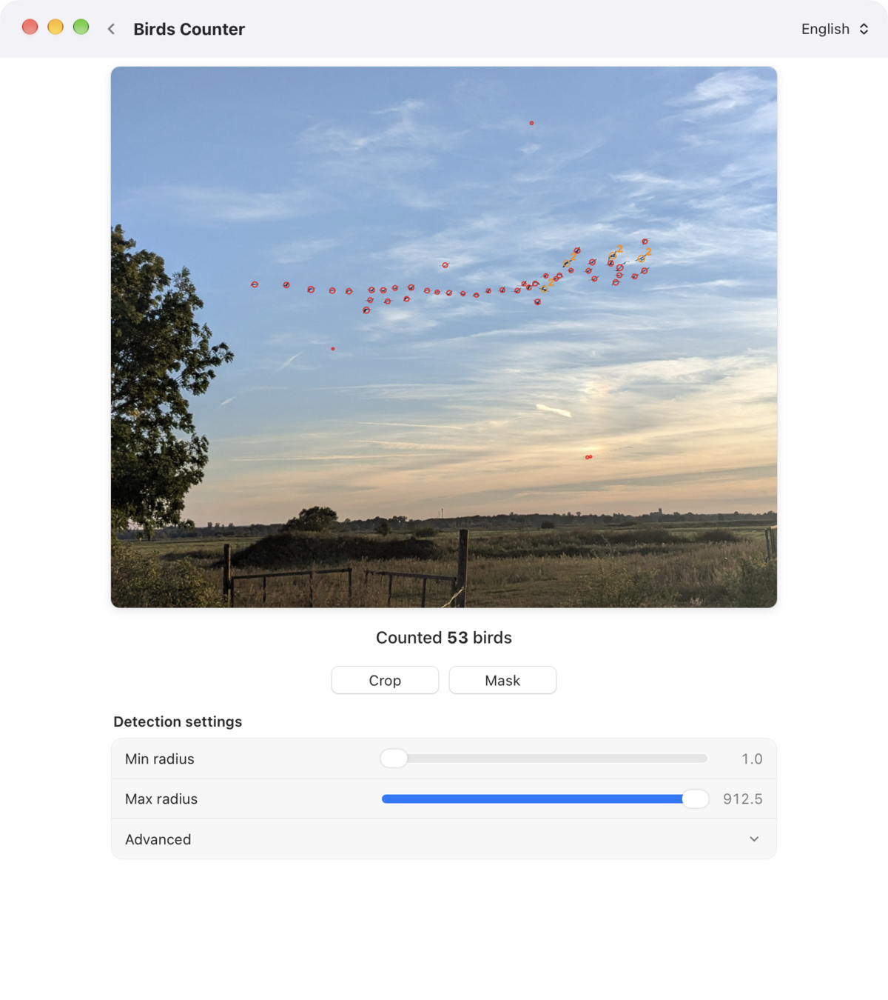
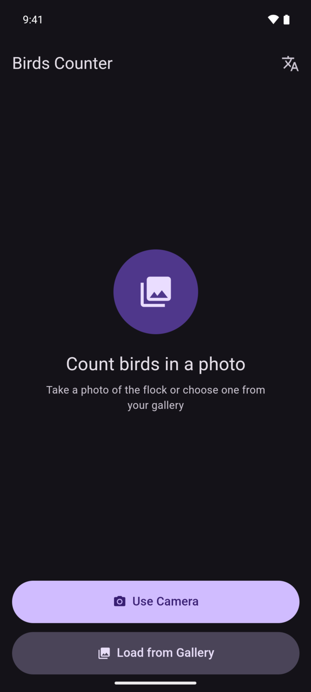
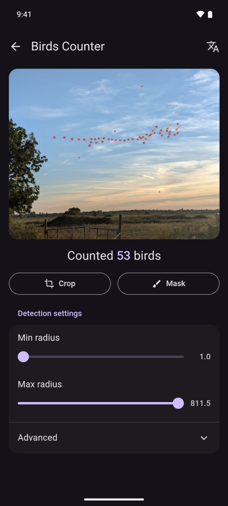
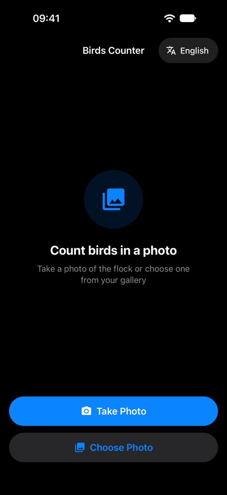
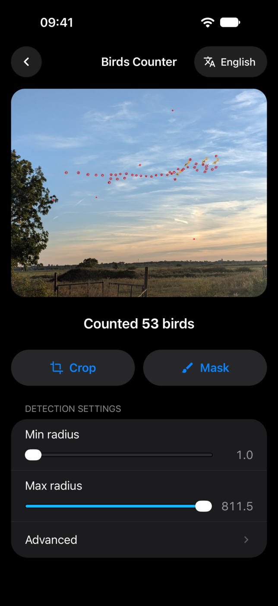

# BirdsCounter

Count the birds in a photo of a flock. BirdsCounter finds the sky, detects the birds against it, circles each one
and tells you how many there are. It runs on macOS, Android and iOS, and each platform gets its own native look.

<p align="center"></p>

| Android | | iOS | |
|:---:|:---:|:---:|:---:|
|  |  |  |  |

The sample photo is [`images/flock.jpg`](images/flock.jpg). With *Only sky* on, the tree, the fields and the fence
are ignored and 53 birds are counted. Without the sky mask the landscape adds over 250 false detections.

## Download

Get the latest build from [GitHub Releases](https://github.com/qoqosz/BirdsCounter/releases):

- **Android:** `BirdsCounter_<version>_android_arm64.apk`, a signed release APK for 64-bit ARM phones.
- **macOS (Apple silicon):** `BirdsCounter_<version>_macos_aarch64.dmg`. It uses OpenCV 5 from Homebrew
  (`brew install opencv`) and is not notarized, so open it with right-click → *Open* the first time.
- **iOS:** build and install from source, see [Build iOS](#build-ios).

## How it works

- Rust backend (`src-tauri/`) for image processing with OpenCV
- Vanilla HTML/CSS/JS frontend (`src/`) for interaction, preview, and controls

The app loads an image, detects bird-like blobs, annotates them with circles, and returns the count.

## Tech Stack

- Tauri 2.12 (`tauri`, `tauri-build`)
- Rust 2024 edition
- OpenCV 5 via `opencv` crate (`0.101`, modules `core`, `imgproc`, `imgcodecs`, `geometry`)
- Frontend: static HTML/CSS/JS (no Node bundler required)


## Detection Pipeline

`process_image` (Rust command, `src-tauri/src/blob_filter.rs`) supports three methods.

**Sky background** (`background`, default):
1. Decode image bytes, convert to grayscale (*Invert* looks for light birds on a dark background)
2. Estimate the sky: a 3×3 opening removes bright specks (sharpening halos around birds, noise peaks), then a
   morphological closing with a *local window* larger than a bird's thickness erases the birds, then box blur
3. Relative darkness (Weber contrast) `(sky − pixel) / sky` after a light Gaussian blur (*Blur*):
   birds are silhouettes, so they stand out against bright and dark clouds alike
4. Local sky texture: median absolute contrast × 1.4826 (a robust standard deviation, capped at 5%) over a window
   3× the local window; birds covering less than half of it do not raise it, so dense flocks stay detectable
5. Threshold per pixel = max(8%, *threshold* × local texture); hysteresis grows detections down to 60% of it,
   so cloud texture needs more contrast than a smooth sky
6. Connected components, radius filtering from pixel area

**Adaptive / Otsu** (classic): blur → threshold → optional inversion → morphological open/close → exclusion mask → external contours → radius filtering.

For all methods, *Only sky* (on by default) first finds the sky: the image is scaled so the local
window spans 5 px, birds are erased by a closing, and areas whose relative gradient (averaged over
~2 windows) exceeds 0.3 count as rough. The sky is the smooth area connected to the top edge plus rough
islands far from the rest (dense flocks); detections touching the rest (trees, roofs, the horizon,
fields) are dropped as a whole. If under 5% of the image is sky, the mask is skipped.

Then blobs over 25× the median detection, or over 3× when touching the image edge
(trees, roofs, lamps), are dropped. *Split merged birds* then compares every blob with the median
area of up to 12 detections of the same flock (within 12 of their own sizes) and counts it as
`round(area / reference)` birds. Single birds are circled in red, merged ones in orange with their count.

### Testing the detector

```bash
cd src-tauri
cargo test --lib
cargo run --release --example count -- --out annotated/ photo1.jpg photo2.jpg
```

The unit tests count birds on synthetic cloudy-sky scenes (faint, touching and light birds,
masks, large dark clutter, landscape below the sky). The `count` example prints the count per file and accepts
`--method`, `--sensitivity`, `--window`, `--min-radius`, `--max-radius`, `--blur`, `--invert`, `--no-split`, `--whole-image`.


## Prerequisites

### Common

- Rust toolchain from `rust-toolchain.toml` (`1.92.0`)
- Tauri CLI 2.x (`cargo tauri ...`)

Install Rust toolchain:

```bash
rustup toolchain install 1.92.0
rustup default 1.92.0
```

Install Tauri CLI (if not installed):

```bash
cargo install tauri-cli --version "^2"
```

### Desktop

- OpenCV 5 available on host system (used by `opencv` crate probing), e.g. `brew install opencv`
- Platform dependencies required by Tauri (WebView/runtime toolchain)

### Android

- Android SDK/NDK and Java 17 toolchain
- Generated Android project already present in `src-tauri/gen/android`
- OpenCV Android SDK folder: `src-tauri/opencv-android-sdk`

### iOS (macOS only)

- Xcode 27 with the iOS SDK, and an Apple ID signed in under Xcode → Settings → Accounts
- OpenCV iOS framework at `src-tauri/opencv2.framework` (download with `./setup_opencv_ios.sh`)
- rustup's `llvm-tools` component (listed in `rust-toolchain.toml`, installed automatically)

## Run in Development (Desktop)

```bash
cargo tauri dev
```

The frontend is served from the static `src/` directory (`frontendDist: "../src"` in `tauri.conf.json`).

## Build Android

1. Download/update OpenCV Android SDK (pinned to `5.0.0`, "16kb-page-fix" package):

```bash
./setup_opencv_android.sh
```

2. Configure release signing (required by `build_android.sh`):
- Option A: file-based
  - Copy `src-tauri/gen/android/keystore.properties.example` to `src-tauri/gen/android/keystore.properties`
  - Fill `storeFile`, `keyAlias`, `storePassword`, `keyPassword`
- Option B: environment variables
  - `ANDROID_KEYSTORE_FILE`
  - `ANDROID_KEY_ALIAS`
  - `ANDROID_STORE_PASSWORD` (or `ANDROID_KEYSTORE_PASSWORD`)
  - `ANDROID_KEY_PASSWORD` (or `ANDROID_KEYSTORE_PASSWORD`)

3. Build:

```bash
./build_android.sh --target aarch64
```

Supported targets:
- `aarch64` (`aarch64-linux-android`)
- `armv7` (`armv7-linux-androideabi`)
- `x86_64` (`x86_64-linux-android`)
- `x86` (`i686-linux-android`)

Output APK:
- `src-tauri/gen/android/app/build/outputs/apk/universal/release/app-universal-release.apk`

Shortcut:

```bash
make android
```

## Build iOS

1. Download the OpenCV iOS framework:

```bash
./setup_opencv_ios.sh
```

2. Build for a device, passing your Apple team ID (shown in Xcode → Settings → Accounts):

```bash
env APPLE_DEVELOPMENT_TEAM=<team-id> ./build_ios.sh --target device
```

3. On the iPhone, turn on **Settings → Privacy & Security → Developer Mode**. If the switch is missing, run any app
   on the phone from Xcode once. Then install:

```bash
xcrun devicectl list devices
xcrun devicectl device install app --device <device-id> src-tauri/gen/apple/build/arm64/birdscounter.ipa
```

4. The first launch needs **Settings → General → VPN & Device Management → Apple Development: … → Trust**, which
   requires an internet connection. With a free Apple ID the app has to be rebuilt and reinstalled every 7 days.

`build_ios.sh` passes the OpenCV settings to cargo as `--config env.*`, because Tauri's Xcode build phase drops
`OPENCV_*` environment variables. The Xcode project links `opencv2.framework` and the Swift 5.6 compatibility library.
The app runs only on physical devices, since the OpenCV framework has no arm64 simulator slice.

## App icons

`src-tauri/icons/icon.png` is the source. After regenerating the icons with `cargo tauri icon`, run:

```bash
./app_icons.sh
```

It fixes what `cargo tauri icon` leaves out. It pads the Android adaptive icon into the launcher's safe zone, and it
copies the iOS icons into the Xcode asset catalog.

## Releases

Publishing a GitHub release runs two workflows, which build the artifacts and attach them to the release. Both
can also be run by hand for an existing tag.

- [`macos-dmg.yml`](.github/workflows/macos-dmg.yml) builds the Apple silicon DMG.
- [`android-apk.yml`](.github/workflows/android-apk.yml) builds and signs the arm64 APK with `./build_android.sh`. It
  needs the repository secrets `ANDROID_KEYSTORE_BASE64` (the keystore, base64-encoded), `ANDROID_KEY_ALIAS`,
  `ANDROID_STORE_PASSWORD` and `ANDROID_KEY_PASSWORD`.

Build outputs such as APKs are not committed.

## Troubleshooting

- `Error: Android release signing is not configured.`
  - Configure `keystore.properties` or required `ANDROID_*` environment variables.

- OpenCV link/probe failures on desktop:
  - Ensure host OpenCV dev libraries are installed and discoverable by `opencv` crate.
  - The project targets OpenCV 5 (`pkg-config --modversion opencv5`). OpenCV 4.x is not supported:
    `contourArea`/`moments` live in the `geometry` module, which only exists in OpenCV 5.

- iOS OpenCV link errors:
  - Verify `src-tauri/opencv2.framework` exists and is valid for selected architecture; re-run `./setup_opencv_ios.sh`.

- Camera does not open on Linux desktop:
  - `open_camera` tries `gnome-photos`, `cheese`, then `ffplay`; install one of them or use gallery input.
