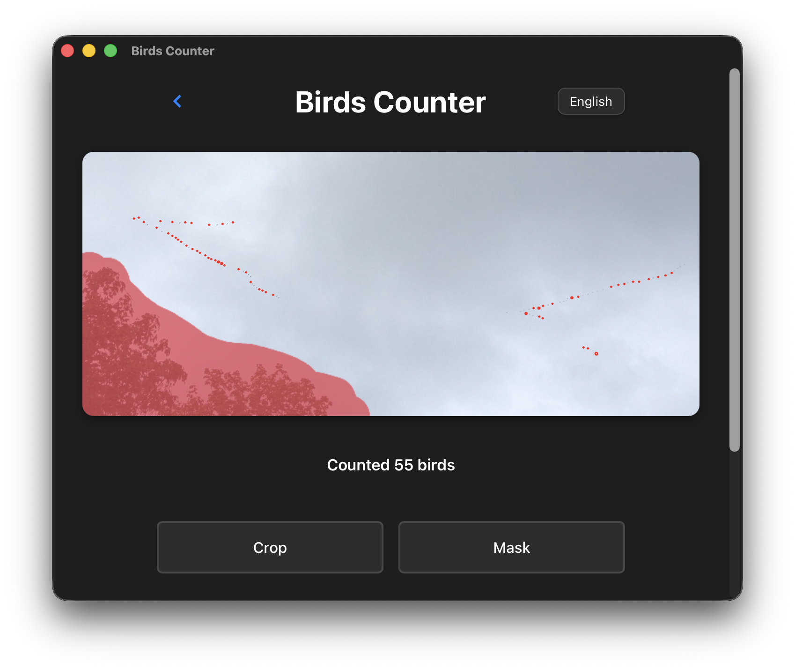

# BirdsCounter



Cross-platform bird counting app built with Tauri:
- Rust backend (`src-tauri/`) for image processing with OpenCV
- Vanilla HTML/CSS/JS frontend (`src/`) for interaction, preview, and controls

The app loads an image, detects bird-like blobs, annotates them with circles, and returns the count.

## Tech Stack

- Tauri 2 (`tauri`, `tauri-build`)
- Rust 2024 edition
- OpenCV 5 via `opencv` crate (`0.101`, modules `core`, `imgproc`, `imgcodecs`, `geometry`)
- Frontend: static HTML/CSS/JS (no Node bundler required)


## Detection Pipeline

`process_image` (Rust command, `src-tauri/src/blob_filter.rs`) supports three methods.

**Sky background** (`background`, default):
1. Decode image bytes, convert to grayscale (*Invert* looks for light birds on a dark background)
2. Estimate the sky: morphological closing with a *local window* larger than a bird's thickness, then box blur
3. Relative darkness (Weber contrast) `(sky − pixel) / sky` after a light Gaussian blur (*Blur*):
   birds are silhouettes, so they stand out against bright and dark clouds alike
4. Local sky texture: RMS of the contrast (capped at 7%) over a window 3× the local window
5. Threshold per pixel = max(8%, *threshold* × local texture); hysteresis grows detections down to 60% of it,
   so cloud texture needs more contrast than a smooth sky
6. Connected components, radius filtering from pixel area

**Adaptive / Otsu** (classic): blur → threshold → optional inversion → morphological open/close → exclusion mask → external contours → radius filtering.

For all methods, blobs over 25× the median detection, or over 3× when touching the image edge
(trees, roofs, lamps), are dropped. *Split merged birds* then compares every blob with the median
area of up to 12 detections of the same flock (within 12 of their own sizes) and counts it as
`round(area / reference)` birds. Single birds are circled in red, merged ones in orange with their count.

### Testing the detector

```bash
cd src-tauri
cargo test --lib
cargo run --release --example count -- --out annotated/ photo1.jpg photo2.jpg
```

The unit tests count birds on synthetic cloudy-sky scenes (faint, touching and light birds,
masks, large dark clutter). The `count` example prints the count per file and accepts
`--method`, `--sensitivity`, `--window`, `--min-radius`, `--max-radius`, `--blur`, `--invert`, `--no-split`.


## Prerequisites

### Common

- Rust toolchain from `rust-toolchain.toml` (`1.92.0`)
- Tauri CLI 2.x (`cargo tauri ...`)

Install Rust toolchain:

```bash
rustup toolchain install 1.92.0
rustup default 1.92.0
```

Install Tauri CLI (if not installed):

```bash
cargo install tauri-cli --version "^2"
```

### Desktop

- OpenCV 5 available on host system (used by `opencv` crate probing), e.g. `brew install opencv`
- Platform dependencies required by Tauri (WebView/runtime toolchain)

### Android

- Android SDK/NDK and Java 17 toolchain
- Generated Android project already present in `src-tauri/gen/android`
- OpenCV Android SDK folder: `src-tauri/opencv-android-sdk`

### iOS (macOS only)

- Xcode + iOS toolchain + signing setup
- OpenCV iOS framework at `src-tauri/opencv2.framework` (download with `./setup_opencv_ios.sh`)

## Run in Development (Desktop)

```bash
cargo tauri dev
```

The frontend is served from the static `src/` directory (`frontendDist: "../src"` in `tauri.conf.json`).

## Build Android

1. Download/update OpenCV Android SDK (pinned to `5.0.0`, "16kb-page-fix" package):

```bash
./setup_opencv_android.sh
```

2. Configure release signing (required by `build_android.sh`):
- Option A: file-based
  - Copy `src-tauri/gen/android/keystore.properties.example` to `src-tauri/gen/android/keystore.properties`
  - Fill `storeFile`, `keyAlias`, `storePassword`, `keyPassword`
- Option B: environment variables
  - `ANDROID_KEYSTORE_FILE`
  - `ANDROID_KEY_ALIAS`
  - `ANDROID_STORE_PASSWORD` (or `ANDROID_KEYSTORE_PASSWORD`)
  - `ANDROID_KEY_PASSWORD` (or `ANDROID_KEYSTORE_PASSWORD`)

3. Build:

```bash
./build_android.sh --target aarch64
```

Supported targets:
- `aarch64` (`aarch64-linux-android`)
- `armv7` (`armv7-linux-androideabi`)
- `x86_64` (`x86_64-linux-android`)
- `x86` (`i686-linux-android`)

Output APK:
- `src-tauri/gen/android/app/build/outputs/apk/universal/release/app-universal-release.apk`

Shortcut:

```bash
make android
```

## Troubleshooting

- `Error: Android release signing is not configured.`
  - Configure `keystore.properties` or required `ANDROID_*` environment variables.

- OpenCV link/probe failures on desktop:
  - Ensure host OpenCV dev libraries are installed and discoverable by `opencv` crate.
  - The project targets OpenCV 5 (`pkg-config --modversion opencv5`). OpenCV 4.x is not supported:
    `contourArea`/`moments` live in the `geometry` module, which only exists in OpenCV 5.

- iOS OpenCV link errors:
  - Verify `src-tauri/opencv2.framework` exists and is valid for selected architecture; re-run `./setup_opencv_ios.sh`.

- Camera does not open on Linux desktop:
  - `open_camera` tries `gnome-photos`, `cheese`, then `ffplay`; install one of them or use gallery input.
