# How BirdsCounter counts birds

A flying bird in a photo is a small dark spot on a lighter sky. That gives us the whole idea:

1. Work out what the sky would look like **if there were no birds**.
2. Compare the photo with that empty sky. Whatever is clearly darker is probably a bird.
3. Throw away anything that is not a bird, such as trees, fields and dark bits of cloud.
4. Count what is left.

This page follows one real photo through every step, using the app's default settings (the *Sky background*
method). All the pictures and numbers come from that photo. The detector runs on the full 2000 × 1623 photo; the
pictures are only shrunk to fit the page. When a tiny bird would vanish in a shrunk black-and-white or coloured map,
the picture is shrunk so that the strongest value wins, which makes the birds look a little fatter than they are.

The code for all of this is in [`blob_filter.rs`](../src-tauri/src/blob_filter.rs).

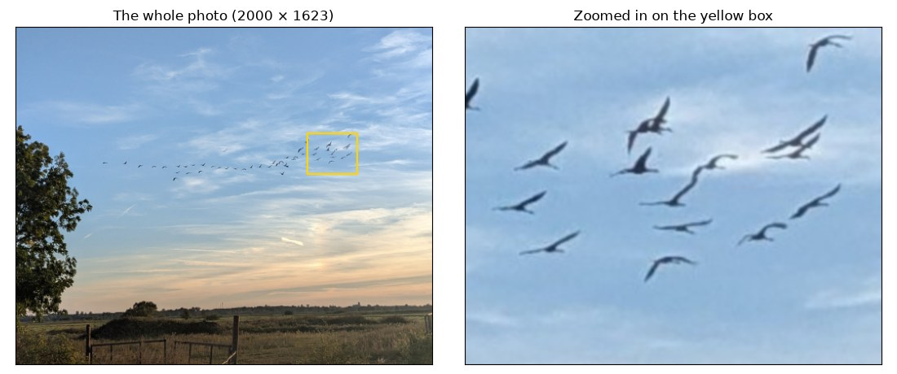

**The answer for this photo is 53 birds.** Let's see how we get there.

Every step ends with a **review note**: why the step is there, what happens without it, and where it is weak. The
numbers come from switching off one step at a time, on this photo and on synthetic scenes where the true count is known.
On this photo more rings is not better, because its true count is unknown. It is also the only real photo tested, so
treat the numbers as evidence and not as proof. [Known gaps](#known-gaps-and-what-was-tried) lists the weak points that
remain and the changes that were tried and rejected.

## The steps at a glance

| Part | Steps | What happens |
| --- | --- | --- |
| Get ready | [1](#step-1-turn-the-photo-grey) | Turn the photo grey |
| Where is the sky? | [2](#step-2-make-a-tiny-copy-and-erase-the-birds), [3](#step-3-measure-how-rough-each-area-is), [4](#step-4-decide-what-counts-as-sky) | Mark trees and fields as "not sky" |
| Paint an empty sky | [5](#step-5-remove-bright-specks), [6](#step-6-erase-the-birds), [7](#step-7-smooth-the-sky) | Make a copy of the photo with no birds in it |
| Find dark spots | [8](#step-8-soften-the-photo-slightly), [9](#step-9-measure-how-much-darker-each-pixel-is), [10](#step-10-measure-how-busy-the-sky-is), [11](#step-11-set-a-pass-mark-for-every-pixel) | Give every pixel a score |
| From pixels to groups | [12](#step-12-keep-every-pixel-that-is-possibly-a-bird), [13](#step-13-remove-whatever-touches-the-landscape), [14](#step-14-group-the-pixels-and-demand-one-strong-pixel) | Join pixels into groups |
| Check the groups | [15](#step-15-check-the-size), [16](#step-16-remove-giant-groups), [17](#step-17-spot-birds-that-overlap) | Remove the wrong ones, spot overlapping birds |
| Finish | [18](#step-18-add-it-all-up) | Add it all up |

## Two tools we will use a lot

A photo is a big grid of numbers, one per pixel. In a grey photo, 0 is black and 255 is white.

Many steps use two very simple operations. Slide a small square, called a **window**, over the photo. At each
position, replace the middle pixel with:

- the **brightest** value inside the window. This is called *dilation*, and bright things grow.
- the **darkest** value inside the window. This is called *erosion*, and dark things grow.

$$
\text{dilate}(p) = \max_{q \in \text{window around } p} I(q)
\qquad
\text{erode}(p) = \min_{q \in \text{window around } p} I(q)
$$

Doing them one after the other gives two useful tricks:

- **Closing** is dilate, then erode. It erases dark things too thin to fit the window.
- **Opening** is erode, then dilate. It erases bright things too thin to fit the window.

Here is a closing with a window 3 pixels wide. A thin dark bird disappears:

```text
photo:    200 200  50  50 200 200 200
dilate:   200 200 200 200 200 200 200
erode:    200 200 200 200 200 200 200    <- the bird is gone
```

And here is the same closing on something wide and dark, like a tree. It comes back unchanged:

```text
photo:    200 200  50  50  50  50  50 200 200
dilate:   200 200 200  50  50  50 200 200 200
erode:    200 200  50  50  50  50  50 200 200    <- the tree is still there
```

Keep this in mind, because it is the trick behind steps 2 and 6.

---

## Get ready

### Step 1: Turn the photo grey

Birds are dark whatever colour the sky is, so colour is not needed. Each pixel becomes one brightness number, using
the standard weights (our eyes are most sensitive to green):

$$
\text{grey} = 0.299 \cdot R + 0.587 \cdot G + 0.114 \cdot B
$$

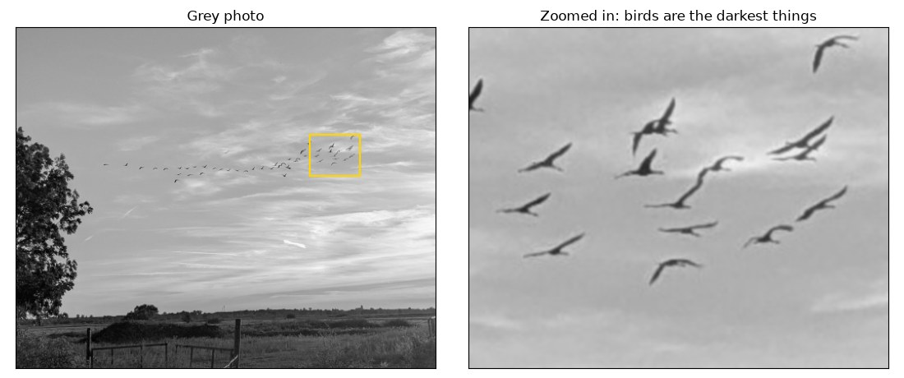

> **Review note.** A bird is a silhouette, so brightness is enough, and one channel takes less memory. No single colour
> channel does clearly better here: blue gives 51, green 52 and red 56, against 53 for grey. The weak point is the
> assumption itself: a bird lighter than the sky scores zero ([gap 3](#gap-3-only-dark-or-only-light-birds)).

---

## Where is the sky?

Birds fly in the sky, so we first find the sky and ignore everything else. Trees and grass are full of small dark
spots that would look just like birds. These three steps can be switched off with the *Only sky* setting.

### Step 2: Make a tiny copy and erase the birds

We don't need detail to tell a sky from a field, so we shrink the photo. The *Local window* setting, $w = 31$, is
roughly "wider than a bird is thick". The setting is for a photo 2000 pixels on its longer side and grows with the whole
photo, so a 4000 pixel photo uses 63. Cropping doesn't change it, because a bird stays the same size in pixels. This
photo is exactly 2000 pixels, so here it is 31. We shrink by enough to make that window only 5 pixels wide:

$$
\text{scale} = \max\left(\frac{w}{5},\ 1\right) = \frac{31}{5} = 6.2
\qquad\Rightarrow\qquad
\frac{2000}{6.2} \times \frac{1623}{6.2} \approx 323 \times 262 \text{ pixels}
$$

Then a closing with a 5 × 5 window erases the birds. Look at the right picture: the flock is gone, but the tree and
the fields are still there, just blocky.

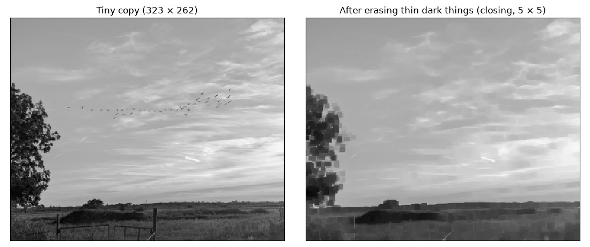

> **Review note.** Without the closing, a flock would look like rough texture and be taken for land. $w$ grows with the
> photo because otherwise the count depends on the resolution. This photo resized to 0.5×, 0.75×, 1.5× and 2× gives 53
> every time, and 3× and 4× give 55 and 58. With $w$ fixed at 31, the same copies give 43, 51, 60, 64, 66 and 74. Resized
> copies have no new detail, so this is only an approximation of real photos at those sizes. The blur, the opening and
> the minimum radius are still in pixels, which is one likely reason why 3× and 4× drift.

### Step 3: Measure how rough each area is

Sky changes slowly from pixel to pixel, while trees and grass jump around. To measure this, we look at how much the
brightness $C$ of the tiny copy changes going right ($G_x$) and going down ($G_y$), using two small patterns called
*Sobel filters*:

$$
G_x = \begin{bmatrix} -1 & 0 & 1 \cr -2 & 0 & 2 \cr -1 & 0 & 1 \end{bmatrix} * C
\qquad
G_y = \begin{bmatrix} -1 & -2 & -1 \cr 0 & 0 & 0 \cr 1 & 2 & 1 \end{bmatrix} * C
$$

Put the two together, and divide by the brightness so that dark and bright areas are treated alike:

$$
g = \frac{\sqrt{G_x^2 + G_y^2}}{\max(C,\ 1)}
$$

The roughness $R$ of a pixel is the average of $g$ over the 9 × 9 square around it. An area counts as **smooth** when:

$$
R \le 0.3
$$

Skies normally stay well under that, even with clouds. Trees, grass and fences go far above it.

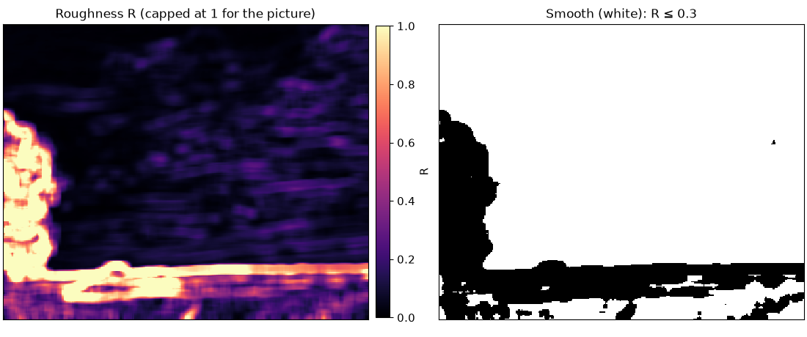

Notice the white patches in the field in the right picture. They are smooth too, but they are not sky. The next step
deals with them.

> **Review note.** The limit of 0.3 looks arbitrary, but it is not critical on this photo: anything from 0.2 to 0.5 gives
> 52–53 birds. The weak point is texture finer than one pixel of the tiny copy: shrinking averages it out, so it can
> look smooth.

### Step 4: Decide what counts as sky

Being smooth is not enough. We use two more rules:

1. **Sky is connected to the top of the photo.** A smooth area only counts as sky if you can walk from it to the top
   edge without leaving smooth pixels. This rules out the smooth patches in the field. Everything else is "not sky".
   There is one exception, for when something blocks the view across the top. If smooth areas at the top cover less
   than 25% of the photo, the largest smooth area counts as sky too, as long as it is larger than they are and at least
   5% of the photo. It must also be at least 1.6 times brighter than they are, unless they cover less than 5%.
2. **Small rough islands far from the land are still sky.** A sharp cloud edge or a very dense flock can look rough.
   To find these, we grow the "not sky" areas by 15 pixels of the tiny copy in every direction, which is about 93
   pixels on the real photo. If a grown piece reaches the edge of the photo, it is landscape. If it floats alone in
   the middle, it is an island and it stays sky. This photo has one tiny island, the orange dot in the left picture,
   in a patch of cloud.

Finally, a safety check. If less than 5% of the photo is sky, the photo is probably not a sky shot (think of birds on
a lake), and the sky mask is not used at all. Here, 75% of the photo is sky, so we use it. The mask is then enlarged
back to the size of the photo.

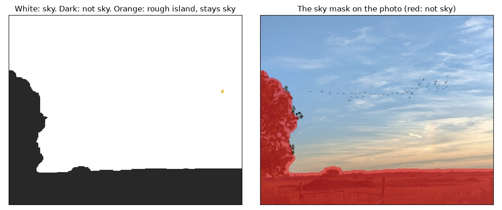

> **Review note.** Rule 1 earns its place: without it this photo gives 139. Its exception changes nothing here, but it
> handles photos where the top is not sky. Without it, a smooth dark band across the whole top finds 0 of 60 birds, and
> branches across the top switch the mask off and count 211. With it, both find 60 of 60, and a photo of trees and a road
> with no sky gives 1 false bird instead of 527. Scenes with real sky at the top don't change: 20 of 20 above a smooth dark
> field, and above a bright lake with boats 21 of 20 with 30% sky and 10 of 10 with 15% sky. The limit of 1.6 comes from
> these scenes and not from real photos. A smooth wall across the whole top that is less than 1.6 times darker than the
> sky still fools the mask.
>
> Rule 2 changes nothing here, but it protects dense flocks: a scene with a ball of 120 overlapping birds inside a flock
> gives 81 with it and 58 without it.

---

## Paint an empty sky

Now we go back to the full-size grey photo and build the most important picture: the same sky with no birds in it.

### Step 5: Remove bright specks

Phone cameras sharpen their photos, which leaves thin bright fringes around birds. Step 6 keeps the brightest values,
so it would spread these fringes around and make the sky look too bright. An opening with a 3 × 3 window removes them
first.

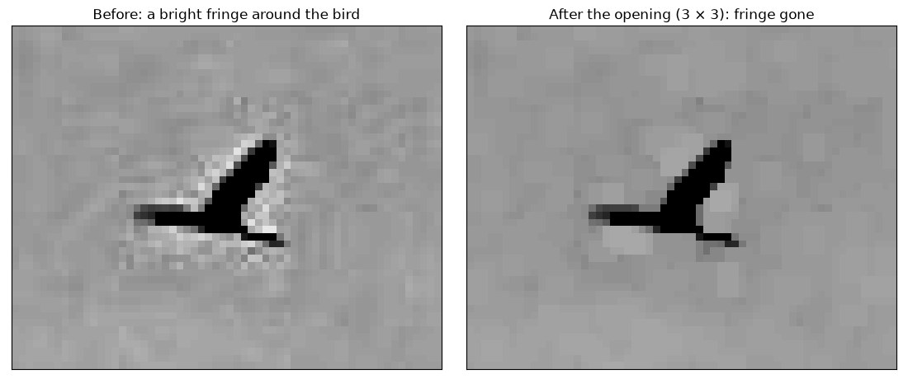

> **Review note.** There is a stronger reason than the fringes. The closing also picks up bright noise peaks, which lifts
> the sky estimate everywhere. Without this step, a scene with uneven light finds 46 of 112 birds and a dense flock of
> thin birds finds 0 of 420. On this photo the count barely moves (52), but 5 groups are lost and 2 appear.

### Step 6: Erase the birds

This is a closing again, this time with the full window of $w = 31$ pixels. Any dark thing survives only if a
31 × 31 square fits inside it. Birds are much thinner than that, so they vanish. Clouds stay, because they change
slowly.

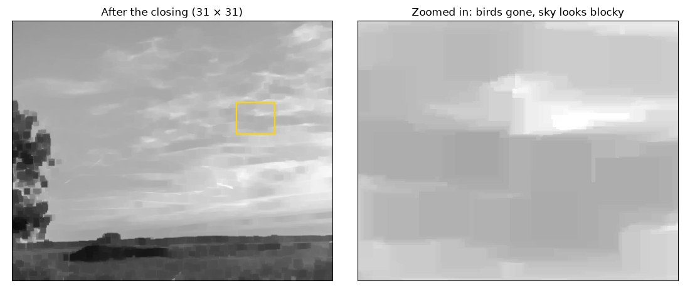

> **Review note.** A plain blur would mix the dark birds into the sky and shrink their contrast. The closing skips them.
> The middle of anything thicker than the window survives as "sky". On a photo 1600 pixels wide, where the window is 25,
> a bird 50 pixels thick is still found by its rim, but its area comes out at about 2,700 pixels instead of 5,500, and
> step 16 then removes it (20 of 21 birds). A solid dark mass of 2,400 birds gives about 40.

### Step 7: Smooth the sky

The closing leaves blocky edges, as the zoomed picture above shows. To smooth them, each pixel becomes the average of
the $w \times w$ square around it. This is called a *box blur*:

$$
S(p) = \frac{1}{w^2} \sum_{q \in \text{window around } p} \text{closed}(q)
$$

The result, $S$, is our **empty sky**.

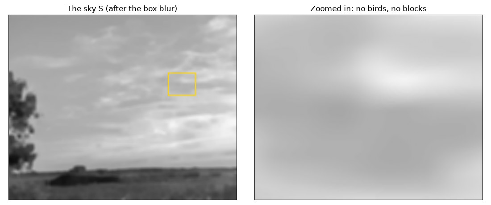

To check it worked, here is one row of pixels from the photo and from $S$. The sky line runs straight across where the
birds dip down, as if they weren't there. It also ignores the bright fringes.

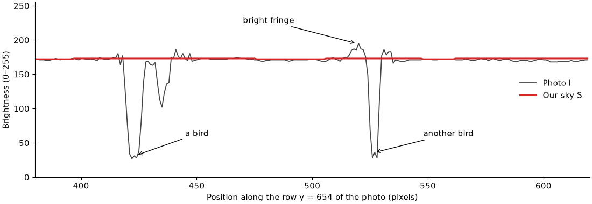

> **Review note.** Without the box blur this photo gives 72 instead of 53, so the blocks do matter.

---

## Find dark spots

### Step 8: Soften the photo slightly

Single noisy pixels shouldn't count as anything, so we blur the grey photo very gently (the *Blur* setting, 3 by
default). Each pixel becomes a weighted average of itself and its 8 neighbours, with the middle counting the most:

$$
I = \frac{1}{16} \begin{bmatrix} 1 & 2 & 1 \cr 2 & 4 & 2 \cr 1 & 2 & 1 \end{bmatrix} * \text{grey}
$$

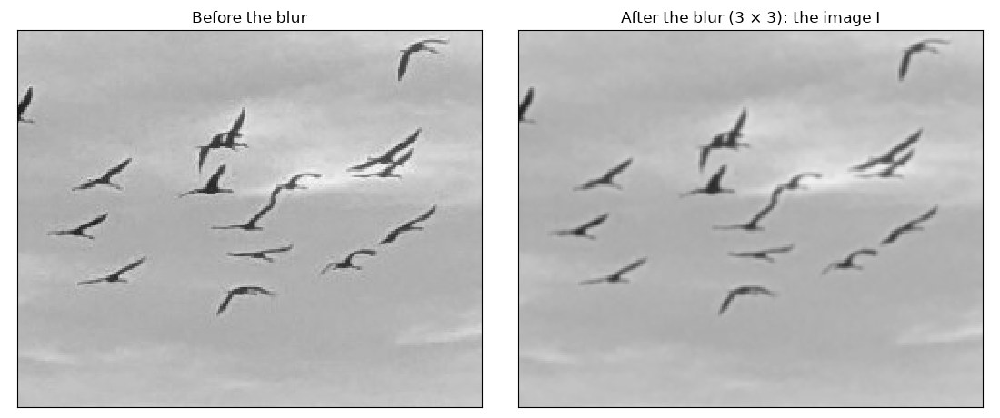

> **Review note.** This is a real trade-off. Without the blur this photo gives 60, and with a 5 × 5 blur it gives 50. A
> bird one pixel thick loses about half of its contrast, and that contributes to
> [gap 2](#gap-2-a-dense-flock-partly-hides-itself): the dense flock scene finds all 420 birds without the blur.

### Step 9: Measure how much darker each pixel is

Now we can compare. For every pixel, we ask: what fraction of the sky's brightness is missing here?

$$
d = \frac{S - I}{\max(S,\ 1)}
\qquad
c = \min(\max(d,\ 0),\ 1)
$$

- $c = 0$ means "as bright as the sky, or brighter".
- $c = 0.5$ means "half as bright as the sky".
- $c = 1$ means "black".

Why divide instead of just subtracting? Because of light levels. A bird of brightness 50 on a sky of 200 has $c = 0.75$.
On a dull evening with everything half as bright, that is 25 on 100, and $c$ is still $0.75$. The number means the same
thing in any light. Scientists call this *Weber contrast*.

A real pixel in the middle of a bird, with sky $S = 173$ and photo $I = 33.6$:

$$
c = \frac{173 - 33.6}{173} = 0.806
$$

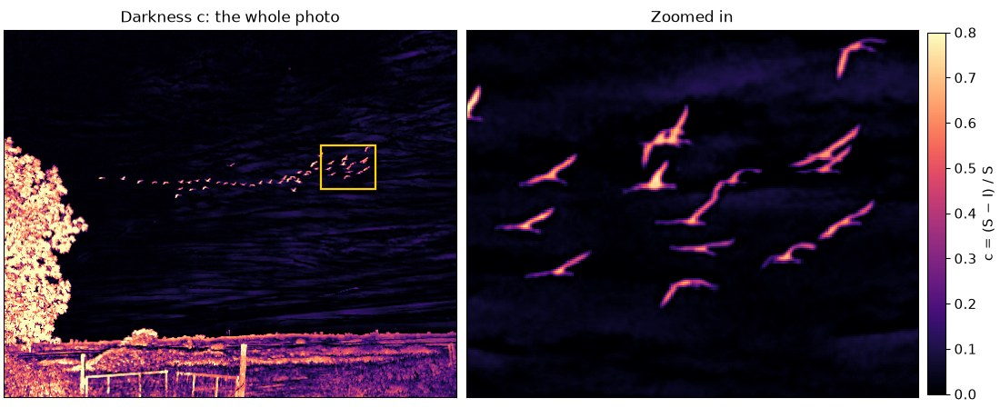

The birds glow nicely. So do the tree and the fields, but the sky mask takes care of those later. Faint streaks in the
clouds glow a bit too, and that is what the next step is for.

> **Review note.** The argument is right, but the measured gain is small: subtracting gives 54 on this photo, and 109
> instead of 112 in a scene where the sky goes from 235 to 55 and birds are 15% darker than it. It costs one division, so
> it stays. With *Invert* the division still uses the real sky and not the flipped one
> ([gap 3](#gap-3-only-dark-or-only-light-birds)). That is also the only case where the upper limit in $\min(\ldots, 1)$
> acts, because otherwise $d$ cannot exceed 1.

### Step 10: Measure how busy the sky is

On a clear blue sky, even a slightly dark spot is suspicious. In streaky clouds, slightly dark spots are everywhere and
mean nothing. So we measure how much the sky wobbles around each pixel, and we call this *busyness*, $t$.

Take the size of the difference, $\lvert d \rvert$, for all pixels in a big $3w \times 3w = 93 \times 93$ square around
the pixel, and pick the **median** (the middle value when sorted):

$$
t = \min\left(1.4826 \times \underset{q \in 93 \times 93 \text{ around } p}{\text{median}} \lvert d(q) \rvert,\ \ 0.05\right)
$$

Three details make this work:

- **Why the median?** Birds are very dark, so an ordinary average would jump near a flock and hide it. The median
  doesn't care how extreme the top values are. Birds barely change it until they fill more than half of the square.
- **Why 1.4826?** This number turns the median of differences into a standard deviation, the usual measure of "typical
  wobble". For bell-curve noise, $\sigma = 1.4826 \times \text{median}\lvert d \rvert$ exactly.
- **Why stop at 0.05?** So that very busy areas can't hide strongly contrasting birds.

To keep this fast, the code limits each $\lvert d \rvert$ to $0.05 / 1.4826 \approx 0.034$ and stores it as a whole
number from 0 to 255. OpenCV's median filter is much faster that way. That filter can't use a window wider than 255
pixels, so very large photos use a copy with fewer pixels for this step.

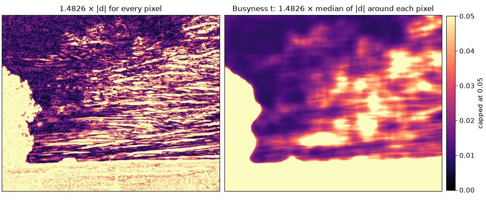

On the right, notice that the flock has left no trace at all. Only the clouds and the land show up. That is the median
doing its job.

> **Review note.** The median is the best defended choice in the whole process. An average-based measure changes this
> photo by one bird (54), but finds 0 of 420 in the dense flock scene. Without the 0.05 limit, a scene with heavy cloud
> texture finds 33 of 60 birds instead of 59. Two claims above go too far:
>
> - "Exactly" holds only when $d$ is centred on zero. The closing gives an upper envelope of the sky, so $d$ is shifted
>   upwards, and $t$ is better read as the typical distance from that envelope.
> - "No trace" holds for this flock, but not for a dense one ([gap 2](#gap-2-a-dense-flock-partly-hides-itself)).
>
> One suspicion did not hold up: that land inside the $93 \times 93$ square raises the pass mark and hides the flock
> above the horizon. Leaving the land out gives 52 instead of 53 at $k = 9$, and no change (60) at $k = 6$. That flock is
> simply too faint.

### Step 11: Set a pass mark for every pixel

Each pixel now gets its own pass mark $T$. It depends on the busyness, multiplied by the *Threshold (× sky texture)*
slider, $k = 9$. It is never lower than 8%, because the detector assumes a bird is at least that much darker than the
sky:

$$
T = \max(0.08,\ k \times t)
$$

So the pass mark is somewhere between $0.08$ on a perfectly calm sky and $9 \times 0.05 = 0.45$ on a very busy one.

Dividing the darkness by the pass mark gives each pixel a **score**. A score above 1 means "passed":

$$
q = \frac{c}{T}
$$

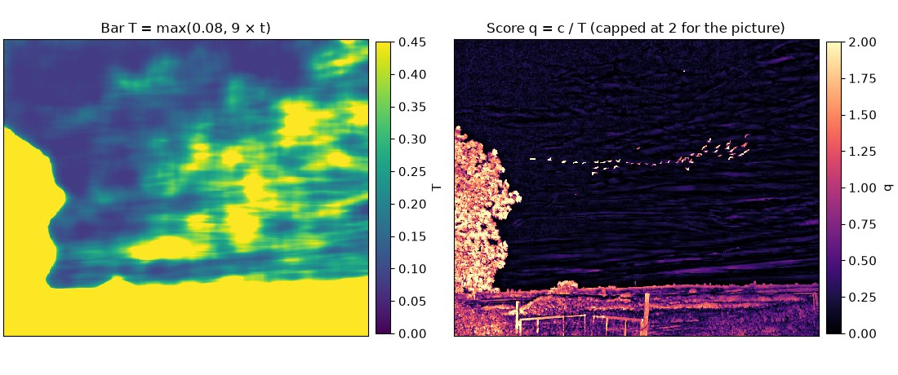

Here are some real pixels from this photo:

| Pixel | Sky $S$ | Photo $I$ | Darkness $c$ | Busyness $t$ | Pass mark $T$ | Score $q$ |
| --- | --- | --- | --- | --- | --- | --- |
| Bird on a calm sky | 173 | 33.6 | 0.806 | 0.011 | 0.095 | **8.45** |
| Tiny, distant bird on a calm sky | 172 | 108.2 | 0.371 | 0.011 | 0.095 | **3.89** |
| Bird on a busy sky | 184 | 59.9 | 0.675 | 0.048 | 0.431 | **1.57** |
| Empty cloud | 191 | 178.9 | 0.063 | 0.038 | 0.342 | 0.19 |
| Empty blue sky | 166 | 164.8 | 0.007 | 0.009 | 0.081 | 0.09 |

All three birds pass and both empty pixels fail, even though the tiny bird is only about half as dark as the bird on
the busy sky. That is exactly what we wanted.

> **Review note.** The floor of 0.08 changes nothing on this photo, for any value from 0.04 to 0.16. It matters on a very
> smooth sky: a scene with faint streaks gives 32 with it and 69 without it (the true count is 30). The slider $k$ is the
> one parameter the result really depends on, as the table in [Where it goes wrong](#where-it-goes-wrong) shows.

---

## From pixels to groups

### Step 12: Keep every pixel that is possibly a bird

Wing tips are thin and pale, so they often score less than the body. If we kept only scores above 1, birds would
lose their wings or break into pieces. So we start with a lower bar, and we will be strict again in step 14:

$$
q > 0.6
$$

On this photo, 362,771 pixels pass this bar, and they form 1,667 connected pieces. Most of them are in the tree and
the fields.

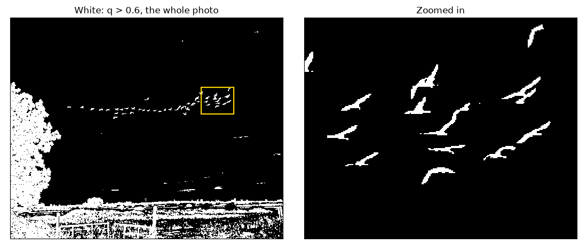

> **Review note.** The value is not critical: 0.5 to 0.8 gives 52–57 birds. Keeping only scores above 1 gives 59, because
> birds break into pieces (8 new groups, 2 lost).

### Step 13: Remove whatever touches the landscape

Now we use the sky mask from step 4. **Any connected piece that touches the "not sky" area is removed as a whole**,
not just the part that overlaps. That way, a branch sticking out into the sky goes away together with the tree it
belongs to. You can see this in the zoomed picture: the tree's outer leaves are red, even though some are outside
the mask.

If you painted a mask by hand in the app, it is applied here too. It works differently: it only cuts off the pixels
you painted. And if you cropped the photo, everything on this page simply runs on the cropped part.

After this step, 6,287 pixels remain, in 117 pieces.

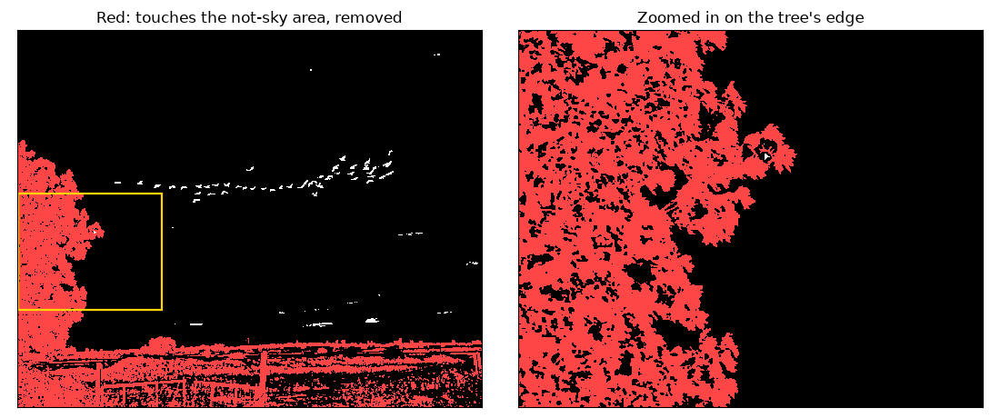

> **Review note.** Only cutting along the mask gives 67, because the branches stay. The cost is that a bird joined to
> something dark goes with it: a wire across the sky takes 5 of 60 birds with it, and a faint streak reaching the ground
> takes 8 of 38. That cost is accepted.

### Step 14: Group the pixels and demand one strong pixel

Pixels that touch, including corner to corner, form one **group**. Now comes the strict test: a group stays only if
**at least one** of its pixels scored above 1:

$$
\max_{p \in \text{group}} q(p) > 1
$$

This two-level test is called *hysteresis*. Think of a pond: a strong pixel is the place where you pour in water, and
the water flows into all the connected weak pixels. A group with no strong pixel never gets any water, and is dropped.

So a bird keeps its pale wing tips (blue in the picture), because they are connected to its body (yellow). A faint
streak of cloud is dropped (red), even if it is big. The biggest group dropped here had 409 pixels, but its best score
was only 0.73.

This takes us from 117 pieces down to **49 groups**.

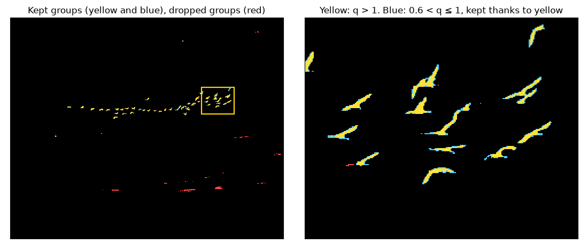

> **Review note.** Without the strict test, keeping everything above 0.6 gives 103. Together with step 12 this is what
> separates pale wing tips from pale clouds, and no single threshold does both.

---

## Check the groups

### Step 15: Check the size

Count the pixels in a group to get its area $A$. Then find the radius of a circle with that same area:

$$
r = \sqrt{\frac{A}{\pi}}
$$

A group stays only if $r$ is within the limits of the *Min radius* and *Max radius* settings:

$$
r_{\min} \le r \le r_{\max}
$$

The minimum is 1 pixel by default. The app sets the maximum to half the photo's shorter side when you open a photo,
which is 811.5 pixels here. (The detector's own default, used by the `count` example, is 100 pixels. It gives the same
53 birds on this photo.)

On this photo nothing is removed, because the groups go from $r = 1.5$ to $r = 7.8$. Birds in one photo are usually
about the same size, as the left chart shows.

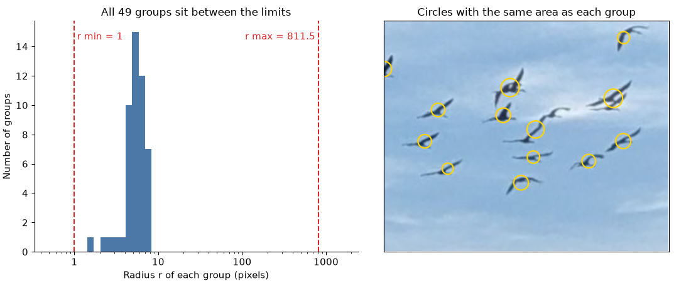

> **Review note.** This step removes nothing here, and setting the minimum to 0 changes nothing either. In the app it is
> mostly a tool for the user: the default maximum, half the shorter side, does not limit anything until the slider moves.

### Step 16: Remove giant groups

A "typical" group is the median of all the areas, $m$. Near birds are much bigger than far ones, so a group is also
compared with its own flock: $m_G$ is the median area of the groups near it, found as in step 17, and $m$ when it has too
few of them. Anything far bigger than both is not a bird. A group is removed if it is:

$$
\frac{A}{\max(m,\ m_G)} > 25
\qquad \text{or} \qquad
\left(\text{it touches the photo's edge and } \frac{A}{m} > 3\right)
$$

The second rule is stricter because large dark things at the edge are nearly always a tree, a roof or a lamp sticking
into the frame. A small bird cut by the edge is fine.

Here $m = 98$ pixels, so the limits are at least 2,450 and 294 pixels. The largest group has 191 pixels, so again nothing
is removed, because the sky mask has already done this job. To see this rule at work, the left picture shows what would
happen with the sky mask switched off. Of 228 groups, 9 would be removed: the whole tree, which alone has 227,338
pixels, and big pieces of the horizon, field and fence. The many small white pieces in the field would stay, and the
count would be 332. That is why the sky mask is needed as well.

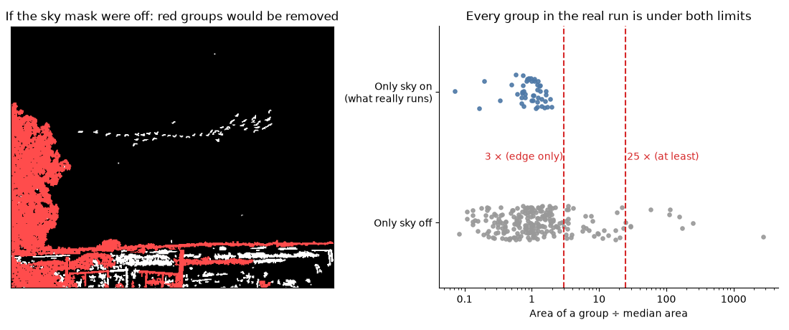

> **Review note.** With the sky mask on it rarely acts, but it is not redundant. With the mask off, removing it gives 704
> instead of 332. It also removes wires, which the mask can't see because the closing erases them. The edge rule still
> compares with the whole photo, because comparing only nearby makes the mask-off count worse (340), so near birds at the
> edge are still at risk ([gap 1](#gap-1-steps-16-and-17-judge-size-too-simply)).

### Step 17: Spot birds that overlap

When two birds overlap, they form one group that is bigger than usual. So we compare each group with its neighbours
to see how many "normal birds" fit in it.

Birds in one part of the photo are at a similar distance from the camera, so their size should be compared only
with nearby birds. For a group $G$ we do this:

1. **Find its neighbours.** Another group $H$ is a neighbour if it is close, measured in $H$'s own size:

   $$\text{distance}(G, H) \le 12 \times \sqrt{A_H}$$

   The group itself counts too. Measuring in $H$'s own size means a tiny speck only counts when it is very close: a
   4-pixel speck must be within $12 \times \sqrt{4} = 24$ pixels. So specks far away can't make a big bird look like
   several.

2. **Check there are enough of them.** With fewer than 4 neighbours we can't tell what is normal, so the group counts
   as 1 bird. Six groups in this photo are like that.

3. **Find the typical size nearby.** Take the median area $m_G$ of its neighbours, using at most the 12 closest.

4. **Divide and round.** The number of birds in the group is:

   $$n = \max\left(1,\ \text{round}\left(\frac{A_G}{m_G}\right)\right)$$

A real example: the circled group has an area of 185 pixels, and the median of its 12 closest neighbours is 111 pixels.

$$
n = \text{round}\left(\frac{185}{111}\right) = \text{round}(1.67) = 2
$$

Zoomed in, you can see that it really is two birds, one over the other. Four groups in this photo count as 2 birds.

(If a photo has more than 4,000 groups, this step is skipped. A photo like that is mostly texture, not flocks, and
comparing everything with everything would be slow.)

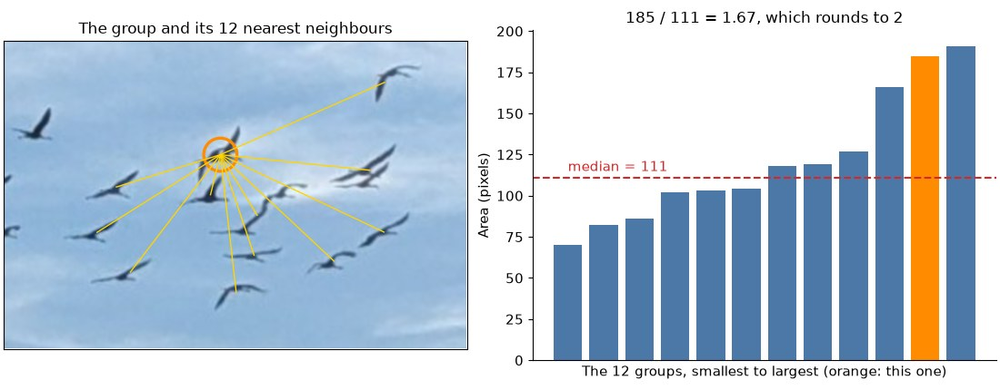

> **Review note.** Without this step the count is 49, so it decides 8% of the result. Area alone can't tell a large bird
> from several small ones. On this photo two of the ratios sit right at the rounding limit of 1.5 (about 1.50 and 1.53),
> so a small change can move the count. See [gap 1](#gap-1-steps-16-and-17-judge-size-too-simply).

---

## Finish

### Step 18: Add it all up

The final count is the sum of the birds in every group:

$$
\text{total} = \sum_{i} n_i = 45 \times 1 + 4 \times 2 = 53
$$

The app then draws a ring on each group: red for one bird, and orange with a number for several.

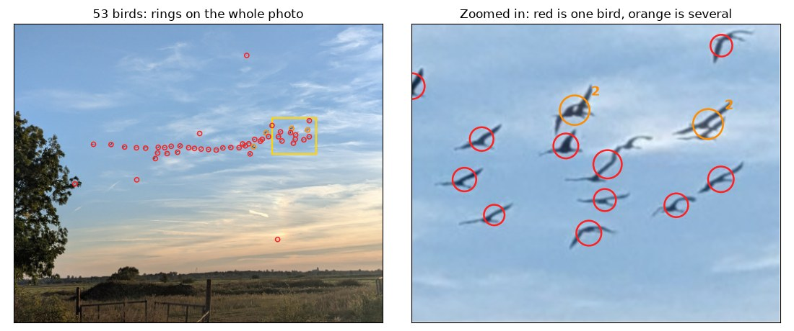

> **Review note.** There is nothing to question in the sum itself. It inherits every error from the earlier steps, and the
> app shows it as one exact number, with no sign of how uncertain it is.

---

## Where it goes wrong

The detector is not perfect, and this photo shows two typical mistakes. 53 is the detector's answer, not the true
number.

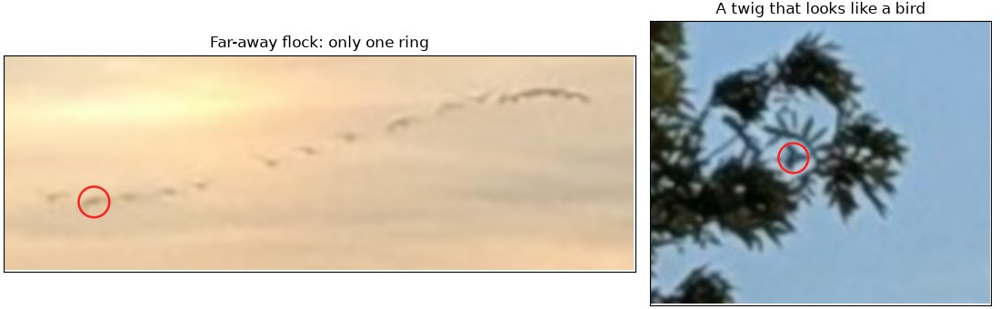

- **A far-away flock is mostly missed (left).** Just above the horizon there is a second flock of about a dozen birds
  (counted by eye), so small and pale that only 6 small pieces of them pass the $q > 0.6$ bar, and just one of those
  reaches $q > 1$. So only one ring lands on them.
- **A twig is counted as a bird (right).** It sits in a gap in the leaves and doesn't touch the rest of the tree in the
  $q > 0.6$ picture, so step 13 doesn't remove it. It is even shaped a bit like a bird.

You can fix these by hand in the app. Paint a mask over the twig, or lower the *Threshold (× sky texture)* slider to
catch the far flock. Lowering it has a cost, though. It catches more of that flock, but it also adds rings elsewhere:

| Slider value $k$ | Birds counted in the photo | Of those, in the far flock |
| --- | --- | --- |
| 9 (default) | 53 | 1 |
| 6 | 60 | 4 |
| 4 | 80 | 8 |

## Known gaps and what was tried

These are the weak points that remain. A change was kept only if it helped its target scene, kept this photo at 53, and
passed all the tests. The ones that didn't are listed here, so nobody has to try them again. In the tables, an arrow goes
from the current result to the result with the change.

Scenes are synthetic, so they show how a mechanism works and not how often it fails on real photos.

### Gap 1: Steps 16 and 17 judge size too simply

*Partly fixed.* Away from the photo's edge, step 16 compares a group with its own flock as well, so 8 near birds next to
60 small ones are all kept (68 of 68). Area alone still can't tell one large bird from several small ones:

- A near bird next to 5 far ones counts as 8 birds (13 instead of 6).
- An isolated ball of 30 birds counts as 1 (41 of 70).
- A ball of 30 birds inside a flock is too low, because overlapping birds cover less area (73 of 90).
- 4 merged birds at the edge are removed (40 of 44), and near birds at the edge are at risk too.

Tried and rejected, because each one fixes one thing and breaks another:

| Change | Better | Worse |
| --- | --- | --- |
| At most 4 birds per group | near bird next to 5 far ones: 13 → 9 (true count 6) | ball of 30 in a flock: 73 → 64 (true count 90) |
| Whole-photo median for groups with few neighbours | isolated ball of 30: 41 → 54 (true count 70) | this photo at $k = 4$: 80 → 135, and the smooth sky scene: 32 → 48 (true count 30) |
| Edge limit of 5 or 8 instead of 3 | 4 merged birds at the edge: 40 → 41 (true count 44) | mask-off count of this photo: 332 → 340 at 5, and 351 at 8 |
| Comparing with $m_G$ at the edge too | nothing in the scenes | mask-off count of this photo: 332 → 340 |

### Gap 2: A dense flock partly hides itself

*Not fixed.* A dense flock of thin birds raises its own busyness about three times, from 0.0067 to about 0.019. A scene
1600 pixels wide, with $w = 25$, finds 373–391 of 420 birds, depending on the noise. With a window of 31 it finds only
273–323, so the median is not the whole answer.

Tried and rejected:

| Change | Better | Worse |
| --- | --- | --- |
| Measuring busyness a second time, without pixels above $q > 1$ | dense flock: 373 → 395 of 420 | ball of 120 birds: 81 → 59 (true count 180), and the slowest step runs twice |
| The same, without pixels above $q > 0.6$ | dense flock: 373 → 420 of 420 | this photo at $k = 4$: 80 → 104, and the ball of 120 as above |
| Measuring only pixels darker than the sky | dense flock: 373 → 420 of 420 | this photo: 53 → 62 |

### Gap 3: Only dark or only light birds

*Partly fixed.* With *Invert*, the contrast is measured against the real sky and not the flipped one, so it means the same
in any light. On a sky going from 170 to 30, it finds 101 of 112 birds that are 15% brighter than the sky, and all 112 of
those 25% brighter. This photo, which has no light birds, gets 21 false detections with *Invert*.

Light and dark birds still can't be counted together: a scene with 20 of each gives 20 either way. Looking both ways by
default could add up to 21 false birds to this photo, so it would have to be a new setting, which is a choice about the
app rather than a fix.

### Left as they are

- *Max radius* has no effect at its default in the app, but it is still useful when the user moves the slider.
- *Adaptive* and *Otsu* add a whole second path through the code. Removing them is a choice about the app, and whether
  anyone uses them can't be told from the code.
- Scaling the blur, the opening and the minimum radius with the photo, like $w$, has not been tried.

## All the numbers in one place

**Settings you can change in the app**

| Setting | Symbol | Default | Step | Meaning |
| --- | --- | --- | --- | --- |
| Local window | $w$ | 31 | 2, 6, 7, 10 | Should be wider than a bird is thick. For a photo 2000 pixels on its longer side, and grows with the photo |
| Blur | | 3 | 8 | Size of the small blur |
| Threshold (× sky texture) | $k$ | 9 | 11 | Lower it to find fainter birds, and raise it to avoid false ones |
| Min radius, Max radius | $r_{\min}$, $r_{\max}$ | 1 and half the photo's shorter side | 15 | Size limits, in pixels |
| Only sky | | on | 2–4, 13 | Ignore everything that isn't sky |
| Split merged birds | | on | 17 | Count big groups as several birds |
| Invert | | off | 2, 5 onward | For light birds on a dark background: step 2 uses an opening instead of a closing, and from step 5 on the grey photo is flipped, while step 9 still divides by the real sky |

**Fixed values in the code**

| Value | Step | Meaning |
| --- | --- | --- |
| 5 | 2 | Size of the window in the tiny copy |
| 0.3 | 3 | Largest roughness that still counts as smooth |
| 15 | 4 | How far "not sky" is grown to find islands, in tiny-copy pixels |
| 25% | 4 | Smooth areas at the top covering this much are trusted to be sky |
| 1.6 | 4 | How much brighter the largest smooth area must be than what blocks the top |
| 5% | 4 | Least amount of sky needed to use the sky mask |
| 2000 | 2 | Longer side of the photo that the *Local window* setting is for |
| 3 | 5 | Size of the window that removes bright specks |
| 1.4826 | 10 | Turns the median of differences into a standard deviation |
| 0.05 | 10 | Largest possible busyness |
| 0.08 | 11 | Lowest possible pass mark |
| 0.6 | 12 | Low bar for pixels, as a fraction of the pass mark |
| 3 and 25 | 16 | Size limits for giant groups, in median areas |
| 255 | 10 | Widest window of the median filter |
| 12, 4 and 12 | 16, 17 | Neighbour distance in own sizes, fewest neighbours, most neighbours used |

## What about the other methods?

The *Threshold* menu in the settings, where *Sky background* is the default, also offers *Adaptive* and *Otsu*. They
replace steps 5 to 12 with a simpler recipe: blur the photo, apply a threshold that doesn't know about the sky, and
clean up with an opening and a closing. Step 13 still runs, and then an outline drawn around each shape replaces step
14. Steps 1 to 4 and 15 to 18 stay the same.

The web version does all of the same steps with OpenCV.js, in [`detector.js`](../src/detector.js).
